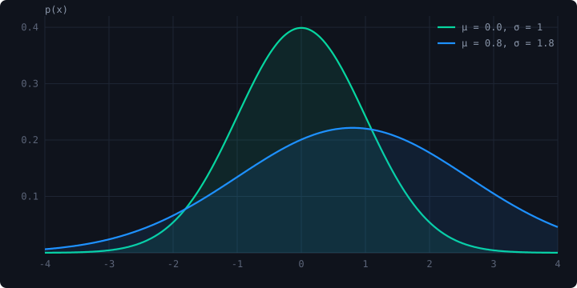

This site is a single static page on GitHub Pages, and I wanted a way to write longer-form notes without adopting a heavy site generator. The result is a ~400-line Python script, `blog.py`, that turns Markdown files in `posts/` into pages that look like the rest of the site. This post exists to exercise every feature and to serve as a reference for future posts.

## Equations

Math is written in standard LaTeX and rendered client-side with [KaTeX](https://katex.org/). Inline math like $\mathbb{E}[Y \mid X = x] = \mu(x)$ sits in the sentence, and display math gets its own block:

$$
P(Y = y \mid \mu, \phi) \;=\; \phi^{1/2}\, e^{-\phi\mu} \left( \frac{e^{-y}\, y^{y}}{y!} \right) \left( \frac{e\,\mu}{y} \right)^{\phi y}
$$

That is the Double Poisson probability mass function, which lets a network model count data with a dispersion parameter $\phi$ that is learned per input rather than fixed globally.[^ddpn] Multi-line derivations work too, using an `aligned` environment:

$$
\begin{aligned}
\log p(x) &\ge \mathbb{E}_{q(z \mid x)}\big[\log p(x \mid z)\big] - \mathrm{KL}\big(q(z \mid x)\,\|\,p(z)\big) \\
&= \mathcal{L}_{\text{ELBO}}(x).
\end{aligned}
$$

Anything KaTeX cannot parse is left as source text rather than breaking the page.

## Code

Fenced code blocks are highlighted at build time with Pygments, so there is no JavaScript involved and the colors are tuned to the site palette. Here is the core of the figure processor that turns a lone image into a `<figure>` with a caption:

```python
class FigureProcessor(Treeprocessor):
    """Turn a paragraph that contains only an image into <figure> + <figcaption>."""

    def run(self, root):
        for parent in list(root.iter()):
            for i, child in enumerate(list(parent)):
                if not self._is_lone_image(child):
                    continue
                img = child[0]
                fig = etree.Element("figure")
                fig.append(img)
                caption = img.get("title") or img.get("alt") or ""
                if caption.strip():
                    etree.SubElement(fig, "figcaption").text = caption
                parent.remove(child)
                parent.insert(i, fig)
```

Inline code such as `uv run blog.py build` is styled as a small chip. Shell sessions highlight as well:

```bash
# Import a markdown file (and its images) from anywhere on disk
uv run blog.py import ~/notes/my-post.md --slug my-post

# Rebuild everything after editing posts/
uv run blog.py build
```

## Figures

An image on its own line becomes a figure. The alt text is used as the caption, and the image is capped at the column width.



Images live next to the Markdown file in `posts/<slug>/` and are copied alongside the rendered page, so relative paths just work.

## Tables and lists

| Feature | Where it happens | Dependency |
|---|---|---|
| Markdown → HTML | build time (`blog.py`) | Python-Markdown |
| Syntax highlighting | build time | Pygments |
| Equations | browser | KaTeX (CDN) |
| Figures, footnotes, tables | build time | pymdown-extensions |

A few conventions worth keeping:

1. Each post is a directory with an `index.md` and its assets.
2. Front matter needs at least a `title`; `date`, `summary`, and `tags` are optional but make the listing nicer.
3. Mark unfinished posts with `draft: true` and they are skipped unless you pass `--drafts`.

> The whole point is that writing a post should feel like writing a README, not configuring a framework.

## How a post gets published

Run the build, check the output locally with `python3 -m http.server`, and push. GitHub Pages serves the `blog/` directory as-is.

[^ddpn]: See *Deep Double Poisson Networks* (ICML 2025) for the full treatment of heteroscedastic count regression.
